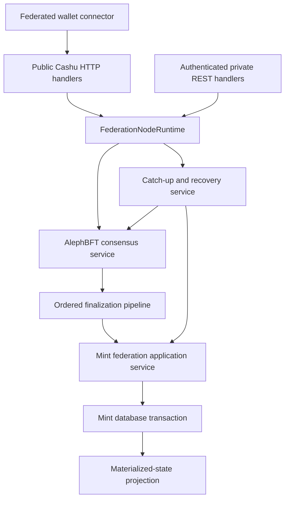

# Federated Cashu refactoring plan

## Purpose

This document reviews the current CDK federation implementation from a code
quality and architecture perspective and defines a staged refactoring plan. The
goal is to make the implementation smaller, easier to navigate, harder to misuse,
and less expensive to maintain without weakening any consensus, journal,
threshold-signing, catch-up, or wallet-recovery invariant.

This is a refactoring plan, not a protocol redesign. Public Cashu behavior,
federation operation ordering, BLS threshold signing, durable operation replay,
and standalone mint behavior must remain unchanged unless a section explicitly
states otherwise.

Two project decisions are fixed for this plan:

1. AlephBFT is the only federation consensus backend. The in-memory consensus
   backend was a development harness and must be removed rather than maintained
   as a second production abstraction.
2. Mint federation implementation files belong under
   `crates/cdk/src/mint/federation/`. The current monolithic
   `crates/cdk/src/mint/federation.rs` should become
   `crates/cdk/src/mint/federation/mod.rs` plus focused submodules.

## Executive assessment

The implementation has a strong protocol foundation:

- Federation operations have canonical, versioned envelopes.
- Operation IDs, request transcripts, conflict keys, and balance audits are
  explicit and deterministic.
- Accepted order, application status, consensus evidence, and materialized-state
  digests are modeled and persisted.
- Minting, swapping, melting, restoration, quote payment observations, and
  keyset rotation pass through explicit federation operations.
- The wallet validates member advertisements and aggregates threshold BLS shares.
- Private member REST requests are authenticated and sequence checked.
- Catch-up verifies accepted ranges and quorum session-outcome evidence.
- The test suite covers many real multi-member, partition, restart, and
  convergence scenarios.

The largest structural weakness is not a lack of abstraction. It is that several
different abstractions and orchestration responsibilities overlap:

- `MintState` has become the owner of much of the federation node runtime.
- `cdk-common` contains two consensus runtime/adapter families covering the same
  backend choice.
- Wallet fanout is generic at the transport level but duplicated at the quorum
  decision level.
- Mint operation application repeats transaction and journal lifecycle work.
- Materialized-state projection re-describes operation effects outside the mint
  application layer.
- Configuration validity is sometimes represented by method naming rather than
  by the type system.
- Large files, particularly the Axum federation test file, make otherwise good
  boundaries difficult to see.

The best refactors therefore establish one owner for each invariant and remove
parallel ways of expressing the same lifecycle.

## Safety invariants

Every refactoring checkpoint must preserve the following invariants.

### Consensus and ordering

- AlephBFT is the sole source of federation operation order.
- No mint, swap, melt, restore, payment-observation, or keyset-rotation operation
  may bypass consensus in federation mode.
- A finalized operation has one stable operation ID and one stable order index.
- Conflict detection remains deterministic and is evaluated against canonical
  operation contents.
- Catch-up cannot append entries without validating the exact accepted range and
  required quorum evidence.
- Gossip sequence watermarks remain liveness/authentication metadata and do not
  become a substitute for consensus order.

### Application and storage

- Domain mutations and terminal application state are persisted atomically.
- Rejected operations do not appear in `completed_operations`.
- A deterministic rejection may carry its standard Cashu `ErrorResponse`, but
  infrastructure and ambiguous failures remain retryable or unresolved.
- Replay is idempotent. Applying the same accepted operation twice cannot issue
  additional value, spend an input twice, or create mismatched quote state.
- A member that was offline can recover accepted order and deterministically
  converge its materialized database state.
- Materialized-state digests cover every consensus-relevant durable effect,
  including persisted rejection metadata, while accepted-order hashes remain
  independent of post-consensus local application metadata.

### Signing and wallet behavior

- Federation mode accepts and signs only v3/BLS aggregate keysets.
- A threshold of valid shares is required before returning an aggregate result.
- Invalid shares are excluded and cannot contribute to threshold success.
- One member cannot determine a consensus-dependent business rejection.
- Threshold agreement on the same standard Cashu error follows the existing
  `ErrorResponse -> Error -> wallet saga -> CLI` path.
- Ambiguous outcomes preserve recoverable wallet saga state.
- Standalone mint and wallet behavior remain unchanged.

### Networking and identity

- Private REST messages remain authenticated against configured federation
  member identity keys.
- Message kind, federation ID, sender ID, session, sequence, and payload bindings
  remain validated where applicable.
- Backpressure, retries, and catch-up must not weaken request authentication or
  duplicate-operation checks.

## Current structural baseline

The following sizes illustrate where responsibilities have accumulated. They are
not quality metrics by themselves, but they identify costly review surfaces.

| File | Approximate lines | Main responsibilities currently combined |
|---|---:|---|
| `crates/cdk-axum/src/federation/tests.rs` | 22,289 | Routes, consensus, faults, partitions, catch-up, restart, digest, DKG, fixtures |
| `crates/cdk-common/src/federation.rs` | 5,963 | Errors, identities, thresholds, payment policy, keysets, DKG, config, invites |
| `crates/cdk-axum/src/lib.rs` | 4,411 | General server state plus federation submission, finalization, catch-up, replay, status |
| `crates/cdk-common/src/federation/consensus.rs` | 3,855 | Consensus items, Aleph adapter, two runtime abstractions, in-memory backend and simulator |
| `crates/cdk-common/src/federation/operation.rs` | 3,381 | Operation payloads, payment evidence/reporting, conflict keys, canonicalization, audits |
| `crates/cdk/src/mint/federation.rs` | 2,660 | Admission and application for every federation operation |
| `crates/cdk/src/wallet/federation.rs` | 2,578 | Connector construction, validation, fanout, quorum decisions, aggregation, recovery |
| `crates/cdk-mintd/src/federation_setup.rs` | 2,411 | Setup orchestration, DKG phases, persistence, validation, output |
| `crates/cdk-sql-common/src/mint/federation.rs` | 2,224 | Every federation SQL record and journal row codec |
| `crates/cdk-axum/src/federation/aleph_bft_session.rs` | 1,399 | Session startup, tasks, activity, rotation, completion, apply loop |

## Target architecture

The target has one directional flow:



The intended ownership boundaries are:

| Concern | Sole owner |
|---|---|
| HTTP parsing and response conversion | Axum handlers |
| Member authentication and private request admission | Private federation request extractor |
| Node task lifecycle and request coordination | `FederationNodeRuntime` |
| Ordering and finality | AlephBFT consensus service |
| Operation admission rules | Mint federation admission module |
| Domain state transitions | Operation-specific mint federation appliers |
| Application transaction lifecycle | Federation apply transaction/context |
| Durable row encoding | Database backend federation codecs |
| Materialized-state effects and digest inputs | Mint federation projection module |
| Wallet member fanout and threshold decisions | Typed wallet quorum collector |
| Wallet recovery policy | Existing wallet sagas and `Error` classification |

## Ranked opportunity matrix

| Rank | Refactor | Value | Risk | Main result |
|---:|---|---|---|---|
| 1 | Extract `FederationNodeRuntime` from `MintState` | Very high | Medium | Axum becomes a thin transport boundary |
| 2 | Remove in-memory consensus and collapse consensus abstractions | Very high | High | One AlephBFT runtime model and no dead backend branches |
| 3 | Introduce a typed wallet quorum collector | Very high | Medium | One implementation of threshold success, rejection, and ambiguity |
| 4 | Move mint implementation into `mint/federation/` | High | Low | Operation-focused modules matching the domain and tests |
| 5 | Centralize federation apply transactions | High | Medium | Atomic status/domain lifecycle cannot be forgotten |
| 6 | Move materialized-state projection into the mint domain | High | Medium-high | Application and digest effects cannot drift apart |
| 7 | Model journal application state explicitly | Medium-high | Medium | Clear order/application boundary in types and persistence |
| 8 | Introduce `ValidatedFederationConfig` | High | Medium | Expensive validity and config digest become construction invariants |
| 9 | Add an AlephBFT session supervisor | High | Medium-high | Explicit task, rotation, recovery, and shutdown lifecycle |
| 10 | Replace the giant test file with a cluster harness and suites | High | Low | Faster diagnosis and reusable fault scenarios |
| 11 | Split federation common types by domain | Medium-high | Low | Smaller public modules and clearer dependencies |
| 12 | Centralize SQL journal row encoding | Medium | Low-medium | Less migration and column-order drift |
| 13 | Add a typed private federation request extractor | Medium | Medium | Uniform authentication, admission, and sequence handling |
| 14 | Replace broad internal string errors with structured runtime errors | Medium | Medium | Better retry decisions and diagnostics without new business-error policy |

## Refactoring checkpoints

Each checkpoint below must be independently reviewable, testable, and committed.
Mechanical moves should not be combined with semantic changes.

## R0. Freeze a behavioral baseline

### Objective

Create a reproducible baseline before moving runtime or consensus code.

### Work

- Record the exact focused test commands for:
  - canonical operation and conflict-key behavior;
  - journal append, replay, application state, and digest verification;
  - AlephBFT unit production and finalization;
  - private REST authentication and sequence rejection;
  - two-, five-, and 11-member convergence;
  - partition, restart, catch-up, and session rotation;
  - federated mint, swap, melt, restore, and check-state;
  - wallet threshold share aggregation and ambiguous recovery;
  - standalone mint and wallet regression coverage.
- Record one fresh five-member fakewallet flow containing mint, swap, and melt.
- Record journal tips, state digests, completed operations, quote states, and wallet
  balances after the flow.
- Ensure tests do not select the in-memory consensus backend as the source of
  expected production behavior. Mark those tests for conversion or deletion in
  R4.

### Tests

- Run formatting checks without changing production behavior.
- Run the focused federation suites with AlephBFT selected.
- Run representative standalone mint and wallet tests.

### Acceptance criteria

- Baseline commands and expected outcomes are documented.
- All behavior-preservation refactors can be compared against the same scenarios.
- Any pre-existing failures are listed separately and are not silently folded
  into refactoring work.

### Suggested commit

`test: establish federation refactoring baseline`

## R1. Reorganize the Axum federation tests

### Objective

Turn the 22,000-line test module into navigable suites and establish a reusable
multi-member harness before production code moves.

### Target layout

```text
crates/cdk-axum/src/federation/tests/
  mod.rs
  fixtures/
    mod.rs
    cluster.rs
    members.rs
    operations.rs
    payments.rs
    transport.rs
    wait.rs
  admission.rs
  private_routes.rs
  aleph_runtime.rs
  aleph_network.rs
  aleph_sessions.rs
  finalization.rs
  catch_up.rs
  state_digest.rs
  restart.rs
  partitions.rs
  payment_observation.rs
  dkg.rs
  metrics.rs
```

### Work

- Move tests without changing assertions or timing first.
- Extract a `FederationTestCluster` that owns member states, transport handles,
  configured thresholds, fake payment backends, and shutdown behavior.
- Give the harness explicit operations:
  - `start` and `shutdown`;
  - `submit` and `submit_to_member`;
  - `partition`, `isolate`, `heal`, and `set_member_online`;
  - `restart_member` and `restart_all`;
  - `await_recorded`, `await_applied`, `await_terminal`, and `await_converged`;
  - `journal_tips`, `state_digests`, and `assert_converged`;
  - fakewallet payment observation control.
- Replace repeated polling loops with bounded helper methods that include useful
  timeout context.
- Keep fault behavior explicit. Avoid a large scenario macro that hides operation
  order or member state.

### Tests

- The moved suite must preserve the original test count.
- Run each new test module independently.
- Run the complete federation-enabled Axum suite once after all moves.
- Confirm harness shutdown leaves no live AlephBFT or HTTP tasks.

### Acceptance criteria

- No production code changes.
- Test names and assertions remain traceable through Git history.
- New fault tests can be written without copying cluster startup code.

### Suggested commits

- `test: extract federation cluster fixtures`
- `test: split axum federation suites`

## R2. Move mint federation code into a directory

### Objective

Make operation ownership visible while preserving every existing public method
and behavior.

### Target layout

```text
crates/cdk/src/mint/federation/
  mod.rs
  admission.rs
  runtime.rs
  quote.rs
  mint.rs
  swap.rs
  melt.rs
  restore.rs
  payment_observation.rs
  keyset.rs
  projection.rs
  tests/
    mod.rs
    admission.rs
    runtime.rs
    quote.rs
    mint.rs
    swap.rs
    melt.rs
    payment_observation.rs
    keyset.rs
```

The existing `crates/cdk/src/mint/federation.rs` must become
`crates/cdk/src/mint/federation/mod.rs`; do not retain both module forms.

### Responsibility map

| Module | Responsibility |
|---|---|
| `mod.rs` | Public facade, narrow re-exports, shared private types |
| `admission.rs` | Pre-consensus deterministic admission and bounds checks |
| `runtime.rs` | Journal entry dispatch and application entry points |
| `quote.rs` | Mint/melt quote creation and quote-state validation |
| `mint.rs` | Paid mint quote consumption and partial blind signing |
| `swap.rs` | Input spending, output balance, and swap signing |
| `melt.rs` | Melt execution, proof state, payment result, and change signing |
| `restore.rs` | Restore request validation and stored share retrieval |
| `payment_observation.rs` | Observation validation, quorum, reports, and quarantine |
| `keyset.rs` | v3/BLS keyset checks and rotation application |
| `projection.rs` | Materialized-state effect collection and digest projection |

### Work

- Perform file movement before introducing new helpers.
- Preserve current method visibility unless a method is proven module-private.
- Keep shared constants in the narrowest module that uses them.
- Avoid a `utils.rs`; name helpers after their domain responsibility.
- Keep test modules alongside their corresponding production modules.
- Run `cargo fmt` after moves, but avoid unrelated formatting churn.

### Tests

- All existing `cdk` mint federation tests.
- Federation-enabled `cdk-axum` compilation.
- Representative standalone mint, swap, and melt tests.

### Acceptance criteria

- This checkpoint changes paths and visibility only.
- No operation serialization, operation ID, conflict key, state transition, or
  database behavior changes.
- `mod.rs` remains a facade rather than becoming the renamed monolith.

### Suggested commit

`refactor: split mint federation operations into modules`

## R3. Extract `FederationNodeRuntime` from Axum `MintState`

### Objective

Make Axum a transport adapter and give federation node orchestration one explicit
owner.

### Target layout

```text
crates/cdk-axum/src/federation/runtime/
  mod.rs
  node.rs
  submission.rs
  finalization.rs
  catch_up.rs
  recovery.rs
  notifications.rs
  status.rs
```

### Runtime ownership

`FederationNodeRuntime` should own or encapsulate:

- the AlephBFT consensus/session service;
- synchronization and readiness state;
- pending response waiters and bounded response cache;
- serialized finalized-unit application;
- catch-up coordination and session-outcome verification;
- pending gossip sequence metadata;
- operation notifications and federation metrics;
- startup replay and recovery;
- task handles and cancellation.

It should depend on a narrow mint application interface and database interfaces,
not on Axum request or response types.

### Work

- Move methods in mechanical groups from `MintState` to the runtime.
- Replace direct `MintState` field access with runtime methods.
- Keep response conversion in HTTP handlers.
- Do not introduce an event bus merely to avoid direct method calls. A narrow
  runtime API is simpler and easier to test.
- Make readiness a runtime-owned state machine rather than a collection of
  handler-level checks.
- Preserve existing metrics names and labels during the move.

### Runtime API sketch

```rust
pub(crate) trait FederationRuntime {
    async fn submit(
        &self,
        envelope: FederationOperationEnvelope,
        source_sequence: Option<FederationSourceSequence>,
    ) -> Result<FederationSubmitOperationResponse, FederationRuntimeError>;

    async fn apply_finalized_unit(
        &self,
        unit: FederationAlephBftFinalizedUnit,
    ) -> Result<FederationFinalizationResult, FederationRuntimeError>;

    async fn apply_catch_up(
        &self,
        response: FederationJournalCatchUpResponse,
        evidence: FederationSessionOutcomeQuorum,
    ) -> Result<FederationCatchUpResult, FederationRuntimeError>;

    fn readiness(&self) -> FederationReadiness;
}
```

The concrete type may be used directly if a trait does not improve testability.
Do not add dynamic dispatch by default.

### Tests

- Unit tests for readiness transitions.
- Submission waiter deduplication and cleanup.
- Duplicate finalized-unit handling.
- Catch-up verification and rejection.
- Replay after restart.
- Existing private and public route tests using the extracted runtime.
- Five-member mint/swap/melt convergence.

### Acceptance criteria

- General `cdk-axum/src/lib.rs` no longer implements federation consensus or
  catch-up algorithms.
- Handlers parse, authenticate, call the runtime, and convert responses.
- Runtime tests do not require constructing an Axum router unless HTTP behavior
  is the subject under test.

### Suggested commits

- `refactor: extract federation submission runtime`
- `refactor: move federation finalization and catch-up runtime`
- `refactor: isolate federation startup recovery`

## R4. Remove in-memory consensus and unify the consensus boundary

### Objective

Delete the development-only in-memory consensus backend and leave one coherent
AlephBFT production architecture.

### Important distinction

`InMemoryFederationJournal` is an in-process representation of a journal used by
runtime logic. It is not necessarily the obsolete in-memory consensus backend.
Do not delete it blindly. After backend removal, rename it to `FederationJournal`
or `FederationJournalView` if the old name is misleading.

### Production types to remove or collapse

- `InMemoryFederationConsensus`;
- `InMemoryFederationConsensusNetwork`;
- `InMemoryFederationConsensusAdapter`;
- production-selectable `InMemory` consensus backend variants;
- `FederationConsensusBackendAdapterRuntime` if it duplicates the surviving
  runtime;
- backend branches whose only purpose is dispatching between in-memory and
  AlephBFT;
- configuration, CLI, and environment values that select `in_memory`;
- compatibility aliases for the undeployed development backend.

### Target consensus boundary

Use one production service with three explicit responsibilities:

1. `AlephBftProposalQueue`
   - accepts validated federation consensus items;
   - bounds queue size and operation size;
   - feeds the active AlephBFT data provider.
2. `AlephBftFinalizationStream`
   - receives finalized units from upstream AlephBFT;
   - validates session and item metadata;
   - yields deterministic ordered decisions.
3. `FederationOrderedJournal`
   - appends finalized operations;
   - verifies order and evidence;
   - exposes catch-up ranges and application state.

Avoid a trait whose only implementation is AlephBFT. Keep narrow traits only at
boundaries that tests genuinely replace, such as transport or durable storage.

### Test replacement strategy

Tests that currently rely on the in-memory backend must move to one of:

- the real upstream AlephBFT runtime with deterministic test timing;
- direct journal tests when the subject is append/replay rather than consensus;
- a small `#[cfg(test)]` fake of a narrow finalization stream when fault injection
  requires exact decisions;
- a transport mock when the subject is network delivery.

Do not preserve a full fake consensus implementation in production modules under
a different name.

### Work sequence

1. Inventory every construction and match on `FederationConsensusBackendKind`.
2. Convert tests that assert backend-neutral behavior to AlephBFT or journal-level
   tests.
3. Remove runtime selection from mint startup and configuration.
4. Collapse `FederationConsensusRuntime` and
   `FederationConsensusBackendAdapterRuntime` into the surviving AlephBFT service.
5. Delete in-memory network simulation types and their production exports.
6. Remove dead errors such as unsupported-backend and external-finalization
   branches that can no longer occur.
7. Rename remaining types that still imply multiple backends.
8. Run unused-dependency and dead-code checks.

### Tests

- Proposal admission, batching, and bounds using AlephBFT.
- Finalized operation order and duplicate-unit behavior.
- Below-threshold non-finality and restored-quorum finality.
- Conflicting operation order under the real backend.
- Restart from pre-backup and post-backup states.
- Partition, heal, catch-up, and convergence.
- No configuration accepts `in_memory`, `memory`, or equivalent aliases.
- No production crate exports an in-memory consensus engine.

### Acceptance criteria

- AlephBFT is the only constructible federation consensus implementation.
- There is one runtime abstraction rather than two enums dispatching over the
  same backend set.
- Production code contains no alternate local-finality shortcut.
- Tests retain deterministic fault injection without shipping a second consensus
  implementation.

### Suggested commits

- `test: move federation consensus coverage to aleph bft`
- `refactor: collapse federation consensus runtime`
- `refactor: remove in-memory federation consensus`

## R5. Introduce a typed wallet quorum collector

### Objective

Centralize member scheduling, typed outcomes, threshold decisions, and ambiguity
while keeping endpoint-specific validation explicit.

### Current duplication

The wallet has one low-level concurrent member collector followed by separate
collectors for mint, melt, restore, mint quote status, melt quote status, batch
quote status, and check-state. Each repeats some combination of:

- threshold calculation;
- timeout and retry policy;
- response collection;
- early stopping;
- matching-view detection;
- inactive-keyset special handling;
- failure formatting;
- insufficient-response errors.

The low-level collector also converts errors into strings too early, which loses
typed information needed for threshold agreement on standard Cashu rejections.

### Target types

```rust
struct MemberOutcome<T> {
    member_id: MemberId,
    attempts: u16,
    result: Result<T, Error>,
}

enum ThresholdDecision<T> {
    Success(T),
    Rejected(Error),
    Ambiguous(QuorumFailure),
}

trait QuorumPolicy<T> {
    type Output;

    fn observe(&mut self, outcome: MemberOutcome<T>);
    fn decision(&self) -> Option<ThresholdDecision<Self::Output>>;
}
```

Exact naming may differ. The important boundary is that scheduling returns typed
member outcomes and operation policies decide what constitutes agreement.

### Policies to support

- Valid BLS share threshold with cryptographic aggregation validation.
- Matching standard `ErrorResponse` threshold.
- Matching mint quote status threshold.
- Matching melt quote status threshold.
- Restore response threshold and aggregate reconstruction.
- Check-state threshold view.
- Optional primary fallback only for the existing quote-creation/status behavior
  where protocol semantics permit it.

### Work

- Separate `MemberFanout` scheduling from `QuorumPolicy` decisions.
- Retain typed errors until the final decision.
- Centralize timeout and retry accounting.
- Make early termination policy-driven: success threshold, matching rejection
  threshold, or impossibility of either outcome.
- Preserve member identity on every response and failure.
- Produce structured ambiguous diagnostics without making strings part of
  behavior.
- Keep BLS share validation in an aggregation policy, not in generic fanout.
- Keep wallet saga behavior unchanged. The connector returns existing `Error`
  values and sagas remain authoritative.

### Tests

- Threshold success with exactly the threshold and with extra members.
- Threshold matching standard rejection.
- Mixed different errors without rejection threshold.
- Mixed successes and errors where success still reaches threshold.
- Insufficient agreement after all responses.
- Timeout and retry exhaustion.
- Invalid share exclusion.
- Inactive or mismatched keyset responses.
- Slow members cancelled after a terminal decision.
- Interrupted receive recovery through restore/check-state.
- Definitive and ambiguous mint/melt wallet saga outcomes.
- Standalone connector behavior unchanged.

### Acceptance criteria

- Endpoint collectors no longer implement their own scheduling loops.
- Typed errors are available to the threshold decision.
- One member cannot decide a consensus-dependent rejection.
- There is no federation-specific business-error classifier.

### Suggested commits

- `refactor: add typed federation member fanout`
- `refactor: unify wallet quorum collection`

## R6. Centralize mint application transactions

### Objective

Make atomic domain mutation and journal application state a structural guarantee.

### Target abstraction

Introduce a narrow transaction context around the existing mint database
transaction:

```rust
struct FederationApplyTransaction<'a> {
    operation_id: FederationOperationId,
    tx: &'a mut dyn MintTransaction,
}

impl FederationApplyTransaction<'_> {
    async fn mark_applied(self) -> Result<(), Error>;
    async fn mark_rejected(self, rejection: ErrorResponse) -> Result<(), Error>;
    async fn rollback(self) -> Result<(), Error>;
}
```

The actual database trait shape should follow existing CDK conventions. The
helper must not hide quote, proof, signature, or payment business logic.

### Work

- Inventory every federation apply method and its transaction boundaries.
- Require every terminal application path to finish through one of:
  `mark_applied`, `mark_rejected`, or explicit rollback/retry.
- Persist deterministic rejection metadata in the same transaction as rejected
  status.
- Keep retryable storage failures non-terminal.
- Ensure drop is not the primary rollback mechanism for a failed write
  transaction.
- Add operation ID and operation kind to transaction tracing.
- Remove duplicated begin/status/commit sequences after conversion.

### Tests

- Failure injection before domain mutation.
- Failure injection after domain mutation but before status update.
- Failure injection after status update but before commit.
- Deterministic rejection commits status and `ErrorResponse` atomically.
- Retryable failure leaves no terminal status or partial domain mutation.
- Replay after process restart completes exactly once.
- Concurrent duplicate application remains idempotent.
- Mint, swap, and melt each have at least one atomicity test.

### Acceptance criteria

- No operation applier manually repeats the standard begin/status/commit
  lifecycle.
- Domain and application state cannot commit independently.
- Explicit rollback occurs on handled transaction failures.

### Suggested commit

`refactor: centralize federation apply transactions`

## R7. Model journal application state explicitly

### Objective

Make the difference between immutable consensus order and mutable post-consensus
application metadata obvious in the type system.

### Target model

```rust
struct FederationJournalEntry {
    // Immutable ordered fields.
    index: u64,
    operation_id: FederationOperationId,
    envelope: FederationOperationEnvelope,
    conflict_keys: Vec<FederationOperationConflictKey>,
    previous_order_digest: FederationJournalDigest,
    order_digest: FederationJournalDigest,
    consensus_evidence: Option<FederationJournalConsensusEvidence>,

    // Post-consensus application metadata, persisted in the existing row.
    application: FederationApplicationState,
}

struct FederationApplicationState {
    status: FederationOperationStatus,
    rejection: Option<ErrorResponse>,
    state_digest: Option<FederationStateDigest>,
    operation_outcome_hash: Option<FederationOperationOutcomeHash>,
}
```

Whether state digest and outcome hash belong in the nested type should be decided
from their precise hash semantics. The minimum required grouping is `status` and
`rejection`.

### Work

- Document which entry fields are covered by accepted-order hashing.
- Document which fields may change after finalization.
- Introduce constructors for ordered entries and legal application transitions.
- Prevent impossible combinations, including:
  - `Applied` with a rejection;
  - `Rejected` without a rejection when the rejection is deterministic and
    representable;
  - non-terminal state with terminal outcome metadata.
- Keep persistence in the existing journal table unless a separate storage
  design is justified independently. This refactor does not add consensus work.
- Update catch-up overlay and verification to compare application state
  explicitly.

### Tests

- Serialization round trips for every legal state.
- Illegal transition rejection.
- Accepted-order digest unchanged when application metadata changes.
- Materialized-state digest changes when persisted rejection metadata changes.
- Catch-up rejects application-state mismatch.
- Old undeployed development formats are removed rather than supported with
  compatibility branches.

### Acceptance criteria

- Order and application metadata are distinguishable from field names and APIs.
- Hashing code cannot accidentally include or exclude mutable fields through
  whole-struct serialization.
- No new table, journal, consensus item, or AlephBFT round is introduced.

### Suggested commit

`refactor: model federation journal application state`

## R8. Move materialized-state projection into the mint domain

### Objective

Eliminate the second description of operation effects currently maintained by
the Axum layer.

### Target design

Add `mint/federation/projection.rs` with a domain API such as:

```rust
impl Mint {
    pub async fn federation_materialized_state_snapshot(
        &self,
        entries: &[FederationJournalEntry],
    ) -> Result<FederationMaterializedStateSnapshot, Error>;
}
```

Internally, an operation can expose deterministic references to affected rows:

```rust
struct FederationMaterializedEffects {
    mint_quotes: BTreeSet<QuoteId>,
    melt_quotes: BTreeSet<QuoteId>,
    proof_ys: BTreeSet<PublicKey>,
    blinded_messages: BTreeSet<PublicKey>,
    completed_operations: BTreeSet<FederationOperationId>,
    payment_observations: BTreeSet<PaymentObservationKey>,
    keyset_rotations: Vec<KeysetRotationKey>,
    rejections: Vec<FederationRejectionKey>,
}
```

This descriptor identifies rows; it does not duplicate the database mutation
logic.

### Work

- Move projection code out of `cdk-axum` without changing row names or fields.
- Add one exhaustive operation-to-effects mapping near operation application.
- Require adding a projection case whenever a new `FederationOperation` variant
  is added.
- Keep canonical row construction deterministic and sorted.
- Consider deriving projection references during application only if they can be
  reconstructed and verified deterministically after restart.
- Keep Axum limited to requesting and comparing the digest.

### Tests

- Golden snapshot rows for every operation kind.
- Rejected operation projection includes rejection but no completed-operation
  row.
- Missing expected row produces a different digest and readiness failure.
- Extra durable effect is detected where the digest scope requires it.
- Reordered database query results produce the same digest.
- Independent members produce identical snapshots after mint, swap, and melt.
- Catch-up member converges to the same snapshot.

### Acceptance criteria

- Axum does not match on `FederationOperation` to infer mint database effects.
- Operation application and projection changes are reviewed in the same module.
- Adding an operation variant causes an exhaustive compiler failure in projection
  code until handled.

### Suggested commit

`refactor: move federation state projection into mint`

## R9. Introduce `ValidatedFederationConfig`

### Objective

Represent full federation configuration validation and its computed digest as a
construction invariant rather than a caller promise.

### Target type

```rust
#[derive(Debug, Clone)]
pub struct ValidatedFederationConfig {
    config: Arc<FederationConfig>,
    digest: FederationConfigDigest,
}

impl ValidatedFederationConfig {
    pub fn try_new(config: FederationConfig) -> Result<Self>;
    pub fn config(&self) -> &FederationConfig;
    pub fn digest(&self) -> FederationConfigDigest;
}
```

### Work

- Perform full v3/BLS keyset, roster, threshold, transcript, payment policy, and
  identity validation once at external import or mint startup.
- Compute and store the config digest during construction.
- Pass the validated type to mint runtime, wallet connector, member verifier, and
  DKG completion paths.
- Remove methods whose safety relies on names such as
  `from_validated_*` while still accepting a raw `FederationConfig`.
- Keep cheap runtime validation for member advertisements and active keysets.
- Decide whether deserialization can construct only raw config, requiring an
  explicit validation boundary before runtime use.

### Tests

- Invalid threshold, roster, identity, transcript, and payment-policy configs.
- Non-v3/non-BLS aggregate keysets rejected.
- Aggregate key/share mismatch rejected.
- Digest computed once and stable.
- Wallet connector cannot be constructed from raw unvalidated config.
- Startup cannot install a raw config in runtime state.
- Standalone startup remains unaffected.

### Acceptance criteria

- Runtime code receives validated configuration by type.
- No hot path performs full BLS aggregate-key interpolation.
- Config digest does not require repeated full validation.

### Suggested commit

`refactor: add validated federation config`

## R10. Add an AlephBFT session supervisor

### Objective

Give AlephBFT task ownership, activity, rotation, recovery, and shutdown one
explicit lifecycle state machine.

### Target states

```text
Stopped
Starting(session)
Running(session)
Rotating(from, to)
Recovering(session)
Stopping(session)
Halted(reason)
```

### Work

- Introduce `AlephBftSessionSupervisor` under the Axum federation runtime.
- Move ownership of session, activity broadcast, network pump, finalized apply,
  and completion-watcher tasks into the supervisor.
- Use one cancellation mechanism and deterministic task joining.
- Make session rotation an explicit transition with preconditions.
- Prevent two active session task sets for the same member.
- Restore durable pending activity and backup state through the supervisor.
- Expose a small status snapshot rather than individual task handles.
- Keep idle behavior event-driven; do not restore periodic empty units.

### Tests

- Start and clean stop.
- Duplicate start rejected or idempotent.
- Rotation only after valid completion conditions.
- Restart with pending operation.
- Restart from persisted backup.
- Task failure transitions to halted/not-ready state.
- Shutdown joins every owned task.
- No activity traffic or CPU loop while fully idle.
- Activity wake and refresh continue while durable pending work exists.

### Acceptance criteria

- Session tasks cannot outlive their supervisor silently.
- Rotation and restart logic do not manipulate task handles from unrelated
  modules.
- Runtime readiness reflects supervisor state.

### Suggested commits

- `refactor: add aleph bft session supervisor`
- `refactor: centralize aleph session rotation and recovery`

## R11. Split common federation types

### Objective

Reduce the 5,900-line common facade and make dependency direction visible.

### Target layout

```text
crates/cdk-common/src/federation/
  mod.rs
  error.rs
  identity.rs
  threshold.rs
  config.rs
  keyset.rs
  payment_policy.rs
  dkg/
    mod.rs
    commitment.rs
    transcript.rs
    state.rs
  operation/
    mod.rs
    mint.rs
    melt.rs
    swap.rs
    restore.rs
    payment_observation.rs
  journal.rs
  consensus.rs
  signing.rs
  transport.rs
  trusted_dealer.rs
```

### Work

- Move types by domain with no wire-format changes.
- Keep the top-level module as a curated public facade.
- Reduce broad re-exports where direct module paths make ownership clearer.
- Separate DKG phase records from finalized public config.
- Consider phase-specific DKG state types only where they eliminate invalid
  transitions without making persistence cumbersome.
- Split payment observation reports from core operation envelope definitions.
- Keep canonical serialization helpers near the types whose hashes they define.

### Tests

- JSON and canonical-byte golden tests before and after moves.
- Operation ID and config digest golden tests.
- Public API compilation for dependent crates.
- DKG transcript and signature validation.
- Trusted-dealer generation unchanged.

### Acceptance criteria

- Pure moves do not change serialization or hashes.
- `mod.rs` is a facade, not another multi-thousand-line implementation file.
- Module imports communicate whether code handles config, operation, journal,
  signing, or transport concerns.

### Suggested commits

- `refactor: split federation config and dkg types`
- `refactor: organize federation operation types`

## R12. Centralize SQL federation row codecs

### Objective

Prevent query column lists, row decoding, and migrations from drifting apart.

### Work

- Introduce a `FederationJournalRow` storage representation with explicit
  conversion to/from `FederationJournalEntry`.
- Centralize the canonical journal select column order if supported safely by the
  existing query API.
- Keep SQL statements static and parameterized. Do not replace clear SQL with an
  ad hoc string builder.
- Group SQL implementation by record family:
  - config and DKG;
  - journal and application state;
  - AlephBFT backup/session data;
  - payment observations and quarantine;
  - member status, sequences, and network retry records.
- Add migration tests that decode rows created before and after each schema
  migration that applies to deployed formats. Undeployed experimental federation
  compatibility should be removed rather than expanded.
- Keep SQLite and PostgreSQL behavior equivalent.

### Tests

- Journal row encode/decode round trip.
- Nullable rejection and consensus-evidence fields.
- Every journal retrieval method uses the same codec.
- SQLite and PostgreSQL query parity where test infrastructure permits.
- Migration from the current development schema.
- Corrupt enum, digest, JSON, and operation ID fields fail with structured
  storage errors.

### Acceptance criteria

- Adding a journal field requires changing one row codec and clearly identified
  SQL/migration sites.
- Repeated select lists cannot silently decode into the wrong field order.
- SQL modules are divided by storage concept rather than one giant implementation.

### Suggested commit

`refactor: centralize federation sql row codecs`

## R13. Add a typed private federation request extractor

### Objective

Make authentication, admission control, message-kind validation, and sequence
handling uniform across private REST routes.

### Target boundary

```rust
struct AuthenticatedFederationRequest<T> {
    sender: MemberId,
    sequence: u64,
    payload: T,
    admission_permit: OwnedSemaphorePermit,
}
```

The exact type should also retain any verified session or federation metadata
needed by the handler.

### Work

- Move admission permit acquisition and signed-request verification into a
  shared extractor or route wrapper.
- Parameterize the expected `FederationRestMessageKind` through a trait or
  route-local constant.
- Make sequence consumption semantics explicit:
  - verification before persistence;
  - persistence only at the intended acceptance point;
  - rejected session/message requests do not consume inappropriate watermarks.
- Keep operation admission separate where it validates canonical federation
  operation contents beyond transport authentication.
- Standardize error conversion and metrics.

### Tests

- Unknown member and bad signature.
- Wrong federation and wrong message kind.
- Replay, skipped sequence, and concurrent duplicate sequence.
- Closed admission semaphore and backpressure.
- Invalid session does not consume sequence when that is the intended rule.
- DKG, status, catch-up, activity, network-message, and finalized-unit routes all
  use the shared boundary.

### Acceptance criteria

- Private handlers begin with an already authenticated typed request.
- No route independently reimplements signature or sequence verification.
- Security behavior remains visible and testable rather than hidden in generic
  middleware with implicit side effects.

### Suggested commit

`refactor: unify private federation request admission`

## R14. Introduce structured runtime and infrastructure errors

### Objective

Reduce broad `Custom(String)` and `anyhow` plumbing in federation runtime code
without creating a federation-specific Cashu business-error policy.

### Error boundaries

Use structured errors for infrastructure layers:

- `FederationRuntimeError` for readiness, lifecycle, and orchestration failures;
- `FederationConsensusError` for proposal/finalization/session failures;
- `FederationTransportError` for authenticated private REST delivery;
- existing storage error types for database failures;
- existing standard Cashu `Error` and `ErrorResponse` for mint business errors.

### Work

- Replace strings that are later parsed, classified, or asserted by text.
- Include structured fields such as member, session, operation ID, expected,
  found, and retryability where deterministic.
- Convert to public HTTP responses only at the route boundary.
- Preserve standard Cashu errors from mint logic unchanged.
- Do not add a federation business-error whitelist or parallel wallet classifier.
- Keep operator diagnostics free of private keys, auth tokens, raw proofs, and
  other secrets.

### Tests

- Structured conversion at each crate boundary.
- Retry decisions do not depend on error display text.
- Standard Cashu business errors round trip unchanged.
- Infrastructure failures remain ambiguous to wallet sagas.
- Logs contain useful identifiers without secret material.

### Acceptance criteria

- Display strings are diagnostics, not control flow.
- Wallet recovery remains governed by existing `Error` behavior.
- Public route behavior and standalone errors remain unchanged.

### Suggested commit

`refactor: structure federation runtime errors`

## Cross-cutting cleanup rules

### Prefer deletion over compatibility

Federated Cashu has not been deployed. Remove old development-only consensus
backend selection, obsolete config variants, stale fixtures, and dead route
semantics. Do not add migrations or compatibility wrappers solely to preserve
experimental in-repo formats unless current tests require migration of a format
the project has explicitly chosen to retain.

### Avoid over-abstraction

- Do not genericize mint, swap, and melt business rules into one opaque processor.
- Do not introduce dynamic dispatch where a concrete runtime has one production
  implementation.
- Do not add a general event bus for direct runtime coordination.
- Do not create `utils`, `helpers`, or `misc` dumping-ground modules.
- Do not move federation logic into macros merely to reduce line count.
- Do not retain the in-memory consensus backend as a test feature. Prefer narrow
  test doubles at actual boundaries.

### Keep standalone code isolated

- Federation mode checks should remain at explicit adapter or dispatch points.
- Standalone mint business logic should be reused where it is already the source
  of truth.
- Standalone storage schemas and wallet connector behavior should not acquire
  federation-only requirements.
- Feature combinations and WASM compatibility must continue to compile where
  currently supported.

### Documentation and commits

- Commit after every coherent checkpoint.
- Use conventional commit messages.
- Keep moves separate from semantic changes.
- Update architecture and progress documents after verified behavior changes.
- Do not commit local paths, generated private member configs, key shares,
  credentials, or machine-specific test artifacts.

## Verification matrix

The following matrix should be run at the checkpoints indicated above and in full
before declaring the refactoring complete.

| Area | Required verification |
|---|---|
| Formatting | `cargo fmt --all -- --check` |
| Common federation types | `cargo test -p cdk-common federation` plus serialization/hash goldens |
| Mint application | Focused `cdk` federation mint, quote, swap, melt, restore, payment, and keyset tests |
| Wallet connector | Threshold success/rejection/ambiguity, invalid share, status, restore, and check-state tests |
| SQL | `cdk-sql-common`, SQLite federation DB tests, and PostgreSQL tests when available |
| Axum routes | Private authentication, public operation routes, readiness, and error conversion |
| AlephBFT | Data provider, network pump, activity wake, finalization, session rotation, backup, and recovery |
| Multi-member | Fresh 3-of-5 and 8-of-11 federation scenarios |
| Fault tolerance | Below-threshold partition, above-threshold partition, heal, restart, delayed member, catch-up |
| End-to-end | Fakewallet mint, swap/send/receive, melt, restore/check-state, and final balance convergence |
| Standalone | Representative non-federated mint, swap, melt, wallet saga, and CLI tests |
| Performance | Idle CPU, request latency, DB contention, network retry volume, and no duplicate quote churn |

## Completion criteria

The refactoring program is complete when all of the following are true:

- AlephBFT is the only federation consensus backend in production code and
  configuration.
- The in-memory consensus engine, network simulator, adapter, and selection
  branches are deleted.
- There is one clear consensus runtime boundary.
- `MintState` no longer implements federation consensus, finalization, catch-up,
  or recovery algorithms directly.
- Mint federation production code lives under
  `crates/cdk/src/mint/federation/` and is organized by operation.
- Wallet fanout preserves typed member outcomes and has one threshold decision
  framework.
- Mint application paths share an atomic application transaction lifecycle.
- Journal order and post-consensus application state are explicitly separated in
  types and hash documentation.
- Materialized-state projection is owned by the mint federation domain, not Axum.
- Runtime components accept a `ValidatedFederationConfig` or equivalent
  invariant-bearing type.
- AlephBFT session tasks have one supervisor and deterministic shutdown.
- Private REST handlers share one authenticated admission boundary.
- Federation test suites are split and use a reusable cluster harness.
- SQL row codecs are centralized enough that schema changes cannot silently
  reorder journal decoding.
- Full fakewallet mint, swap, melt, restore, partition, restart, and catch-up
  flows pass with converged journals and materialized-state digests.
- Standalone CDK behavior and tests remain unchanged.

## Recommended execution order

The safest sequence is:

1. R0: freeze the behavioral baseline.
2. R1: extract the test cluster and split test suites.
3. R2: move mint federation code into the required directory structure.
4. R3: extract the node runtime from Axum.
5. R4: convert tests to AlephBFT, collapse consensus abstractions, and delete the
   in-memory backend.
6. R5: introduce typed wallet fanout and quorum decisions.
7. R6: centralize application transactions.
8. R7: model journal application state explicitly.
9. R8: move materialized-state projection into the mint domain.
10. R9: introduce validated configuration.
11. R10: add the AlephBFT session supervisor.
12. R11-R14: finish common-module, SQL, private-route, and structured-error
    cleanup.
13. Run the complete verification matrix and update the federation architecture
    and progress documentation.

This order front-loads test clarity and mechanical moves, then removes duplicate
architecture, and only afterward introduces invariant-bearing helpers. It keeps
each commit reconstructable and gives failures a narrow likely cause.
